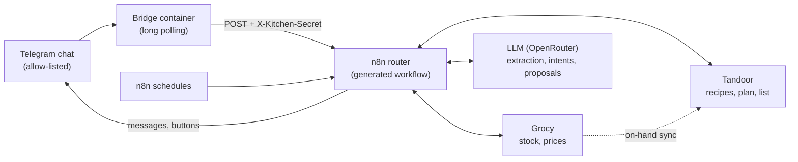
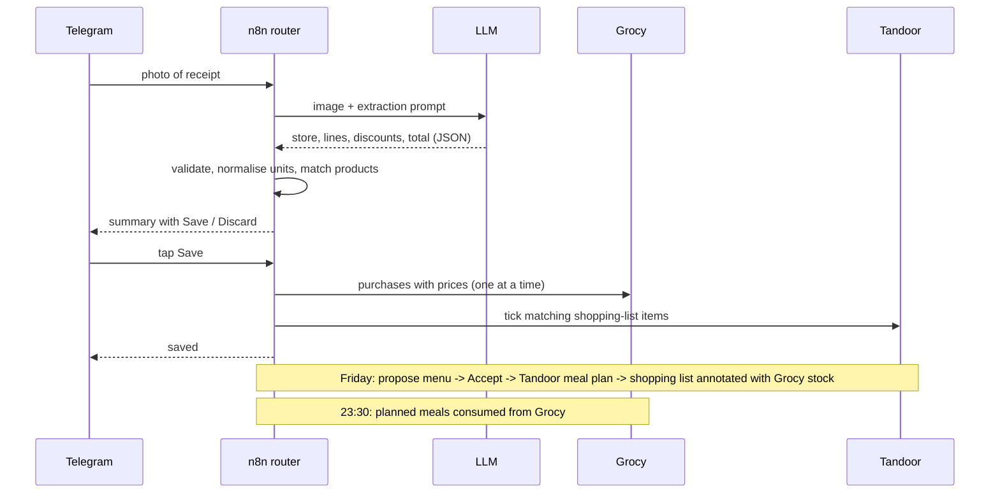

# pi-kitchen-assistant

A self-hosted kitchen assistant you talk to in a Telegram chat. It reads receipts into your pantry, proposes a weekly
batch-cooking menu, turns the accepted menu into a shopping list and keeps stock honest without anyone opening a
dashboard. It runs on a Raspberry Pi (or any Docker host) and is built from [Grocy](https://grocy.info) (stock),
[Tandoor Recipes](https://tandoor.dev) (recipes, meal plan, shopping list) and [n8n](https://n8n.io) (logic), with an LLM
for the fuzzy parts.

The n8n workflows are **generated by Python scripts**, not drawn: the router is ~196 nodes, the prompts live next to
the code, and every environment-specific value (chat IDs, credentials, URLs, models, timezone) comes from environment
variables. Narrative and lessons learned: see the blog post this repository backs (link added when published).

> Status: personal project shared as a reference implementation. The bot's user-facing messages are in Spanish
> (see [Internationalisation](#internationalisation)).

## Features

- **Receipt photo or PDF -> stock.** A vision model extracts store, lines, quantities, discounts and total; code
  normalises units, matches products, creates unknown stores/products, rejects non-grocery tickets and asks for
  confirmation (Save / Discard) before writing to Grocy. Text replies correct the pending ticket.
- **Photo of groceries without a ticket** (market stalls): estimated quantities and prices scaled to the total in the caption.
- **Consumption by chat:** "I cooked X for 4" consumes the recipe ingredients and stores portions; "I ate 2 yogurts"
  consumes stock; a nightly job consumes the planned meals, with undo when a meal was skipped.
- **Weekly menu:** Friday proposal (2 batch lunches, 3 dinners, optional personal breakfasts/snacks) picked from your
  Tandoor recipes using stock, expiring items, recent history and season; edit it in plain text, accept it, and the
  shopping list follows. Items already at home are annotated.
- **Sunday batch session:** an equipment-aware timeline that interleaves recipes across burners/air fryer/rice cooker,
  saved as a Tandoor recipe, with fridge-vs-freezer portioning and a "batch done" button.
- **Alerts and reports:** pantry-to-Tandoor on-hand sync, daily expiry alert, monthly spend report.
- **"Cook X" recipe generation and URL import:** send a recipe link or ask for a dish by name.

## Architecture



One rule keeps it coherent: **Grocy is the only writer of stock**; Tandoor only reads what is on hand.
Workflow state (pending tickets, the current week, history) is kept in n8n workflow static data.

### Flows



## Repository layout

```
.
├── README.md
├── docs/SETUP.md                   full from-zero setup guide, scheduled jobs, troubleshooting
├── docker-compose.example.yml      Grocy, Tandoor (+Postgres), n8n, Telegram bridge
├── .env.example                    every variable, placeholders only
├── generator/
│   ├── config.py                   env-driven configuration (chat ids, credentials, URLs, models, timezone)
│   ├── build_kitchen_router.py     router workflow generator (prints JSON to stdout)
│   └── build_kitchen_jobs.py       scheduled job workflows generator (writes kitchen-*.json)
├── bridge/bridge.py                Telegram long-polling -> n8n webhook forwarder
├── scripts/
│   ├── build.sh                    generate all workflow JSON into build/
│   ├── create_credentials.sh       create the n8n credentials the workflows reference
│   ├── deploy.sh                   import + publish + restart + wait for the live webhook
│   ├── harness.sh                  simulate Telegram updates and print the bot's replies
│   ├── seed_master_data.py         create the Grocy/Tandoor master data the generator expects
│   └── set_bot_commands.sh         register the Telegram command menu
└── recipes/
    ├── load_recipes.py             idempotent recipe-pack loader for Tandoor
    ├── enrich_recipes.py           LLM rewrite of recipes into structured steps
    └── sample_recipes.py           two made-up recipes showing the pack format
```

## Requirements

Docker with Compose v2, a Telegram bot, an OpenRouter (or OpenAI-compatible) key, about 4 GB RAM, `python3` for the
generators (standard library only). Details and tested versions in [docs/SETUP.md](docs/SETUP.md#1-prerequisites).

## Quick start

```bash
git clone <this repo> pi-kitchen-assistant && cd pi-kitchen-assistant
cp .env.example .env && chmod 600 .env          # fill in the secrets (see docs/SETUP.md)
docker compose -f docker-compose.example.yml up -d

# open Grocy (create API key), Tandoor (admin + token) and n8n (owner account), put the keys in .env
python3 scripts/seed_master_data.py             # locations, units, aisles, userfields, meal types
scripts/create_credentials.sh                   # n8n credentials with the ids the workflows expect
scripts/build.sh                                # generate workflows from the environment
scripts/deploy.sh build/kitchen-router.json  KitchenRouter001 \
                  build/kitchen-onhand.json  KitchenOnhand001 \
                  build/kitchen-expiry.json  KitchenExpiry001 \
                  build/kitchen-monthly.json KitchenMonthly01
scripts/harness.sh text "/ayuda"                # or just write /ayuda to your bot
```

The step-by-step version (BotFather, privacy mode, finding chat IDs, first-run screens, credentials, verification,
troubleshooting) is [docs/SETUP.md](docs/SETUP.md).

## How the generator and deploy work

`generator/build_kitchen_router.py` builds the n8n workflow as a Python data structure: node builders (`http`, `code`,
`switch`, `tg_send`...), Code-node JavaScript kept as string constants, prompts and JSON schemas next to them, and the
connections. `config.py` supplies everything environment-specific, so the same code generates a workflow for any
household:

```bash
set -a; . ./.env; set +a
python3 generator/build_kitchen_router.py > out.json     # router, prints JSON
python3 generator/build_kitchen_jobs.py build/            # job workflows
```

Placeholders embedded in prompts and JavaScript (`__PERSONAL_NAME__`, `__TANDOOR_PUBLIC_URL__`, `__LOCALE_HINT__`)
are substituted at the end. Because workflows are text, prompt changes are reviewable diffs. `deploy.sh` imports each
JSON with the n8n CLI, publishes it, restarts n8n and waits until the webhook really answers.

### How personal values are parameterised

| Value | Variable |
|---|---|
| Telegram chat IDs (who may talk / who gets scheduled messages) | `KITCHEN_ALLOWED_CHAT_IDS` / `KITCHEN_CHAT_IDS` (required) |
| Bot token, webhook secret, API keys | `TELEGRAM_KITCHEN_BOT_TOKEN`, `KITCHEN_WEBHOOK_SECRET`, `GROCY_API_KEY`, `TANDOOR_API_TOKEN`, `OPENROUTER_API_KEY` |
| Service URLs | `GROCY_API_URL`, `TANDOOR_API_URL`, `TANDOOR_PUBLIC_URL`, `OPENROUTER_API_URL`, `*_BASE_URL` for scripts |
| n8n credential ids/names | `N8N_CRED_<TELEGRAM\|GROCY\|TANDOOR\|OPENROUTER\|BRIDGE>_<ID\|NAME>` |
| Timezone | `KITCHEN_TIMEZONE` |
| Models | `KITCHEN_MODEL`, `KITCHEN_GUIDE_MODEL`, `ENRICH_MODEL` |
| Household description, personal-block name, locality | `KITCHEN_HOUSEHOLD`, `KITCHEN_PERSONAL_NAME`, `KITCHEN_LOCALE_HINT` |
| Webhook paths | `KITCHEN_WEBHOOK_PATH`, `KITCHEN_PLANNER_HOOK_PATH` |

## Limitations

- **Spanish bot, Spanish master data.** Locations, units, aisles, meal types and keywords are Spanish literals.
- **State in n8n static data.** The current week, pending tickets and history live in workflow static data. Back up the
  n8n volume; use the planner `snapshot` / `restore` actions around risky changes.
- **No automated tests** for the workflows: verification is a manual harness that fires simulated webhooks and reads
  execution results. LLM output is validated in code, but behaviour depends on the models you choose.
- **LLM cost and quality.** Cheap models are enough for extraction and intents; batch planning and recipe rewriting
  need a stronger one. Prompts rely on structured-output support in the provider.
- **Matching is word-list based.** Product matching between receipts, Grocy and Tandoor uses fuzzy word matching with
  a short list of "processed form" words (Spanish); it does not learn from corrections.
- **Prompt-only variety rules.** "Do not repeat the same protein" is a prompt rule, not a code filter.
- **Single household.** One Grocy/Tandoor instance and one set of chats; no multi-tenant support.
- **Tested with** n8n 2.43, Grocy 4.7, Tandoor (recipes `latest`) at the time of writing; `latest` tags move.

## Security notes

- **Run it behind a VPN or private network.** Do not expose Grocy, Tandoor or n8n to the Internet. Compose publishes
  the UIs on `127.0.0.1` by default (`BIND_ADDR`).
- **No inbound ports for the bot.** The bridge long-polls Telegram, drops updates from chats not in the allow-list
  and forwards the rest to n8n over the internal Docker network with a shared-secret header. The n8n webhooks reject
  requests without it.
- **Secrets live in `.env`** (git-ignored) and n8n's encrypted credential store; nothing secret is generated into the
  workflow JSON (only credential ids/names).
- Receipts, stock names and recipes are sent to your LLM provider. Anyone in an allowed chat can use every command.

More in [docs/SETUP.md](docs/SETUP.md#10-security-notes).

## Internationalisation

User-facing bot messages, prompts' examples and master-data names are Spanish. To translate: edit the message strings
and `HELP_TEXT` in `generator/build_kitchen_router.py` / `build_kitchen_jobs.py`, the Spanish literals for locations,
units and aisles (see [docs/SETUP.md](docs/SETUP.md#5-master-data-the-generator-expects)), the intent examples in
`INTENT_PROMPT`, and regenerate. Making the strings a locale table is the obvious next step.

## License

[MIT](LICENSE) (c) SaskullOps
